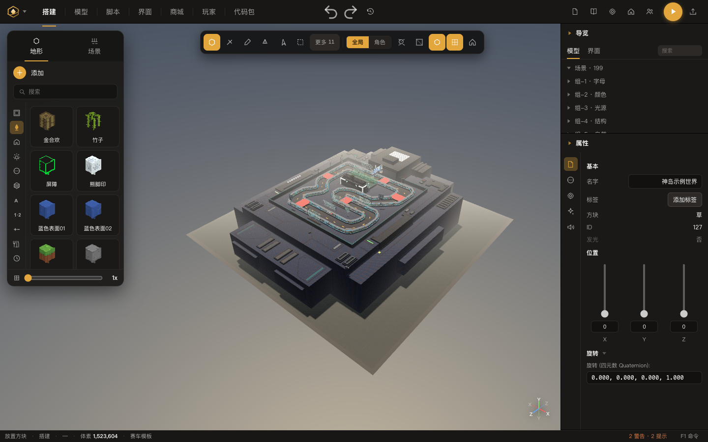
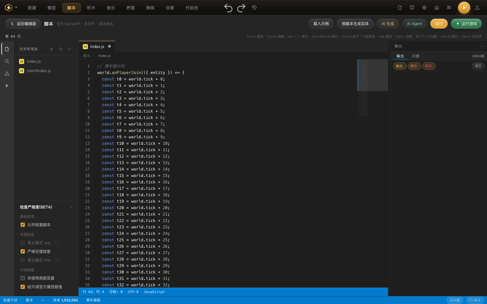
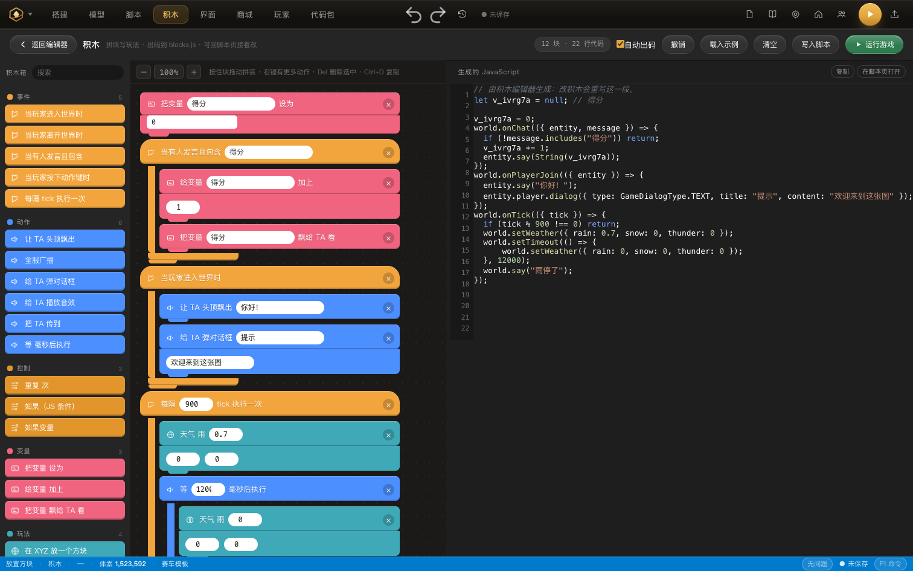
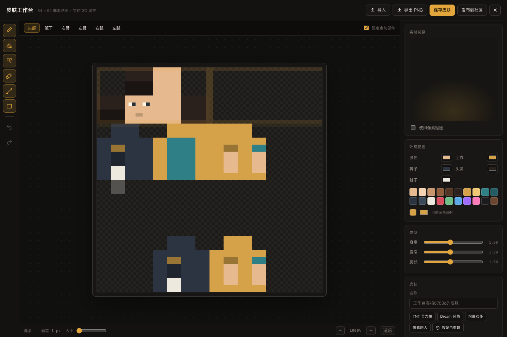
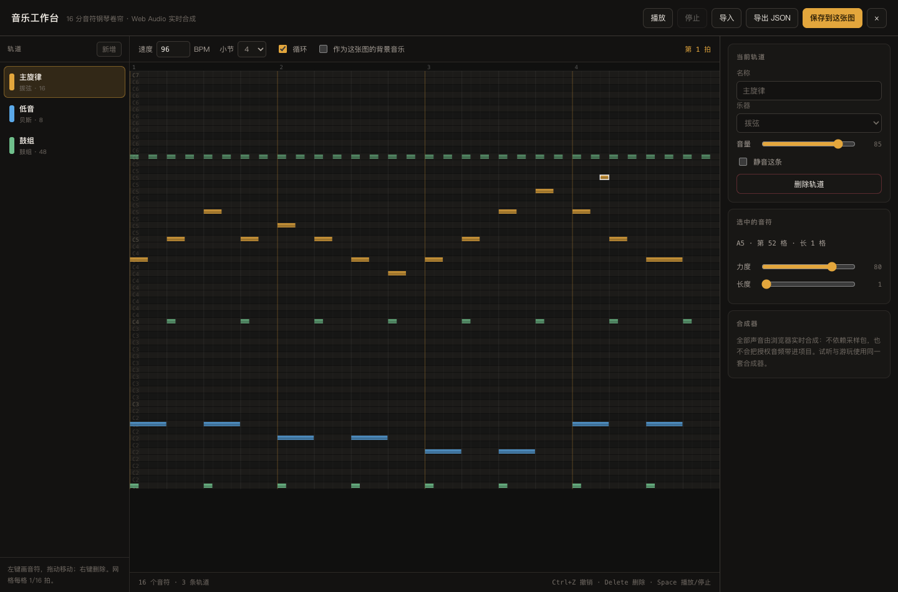
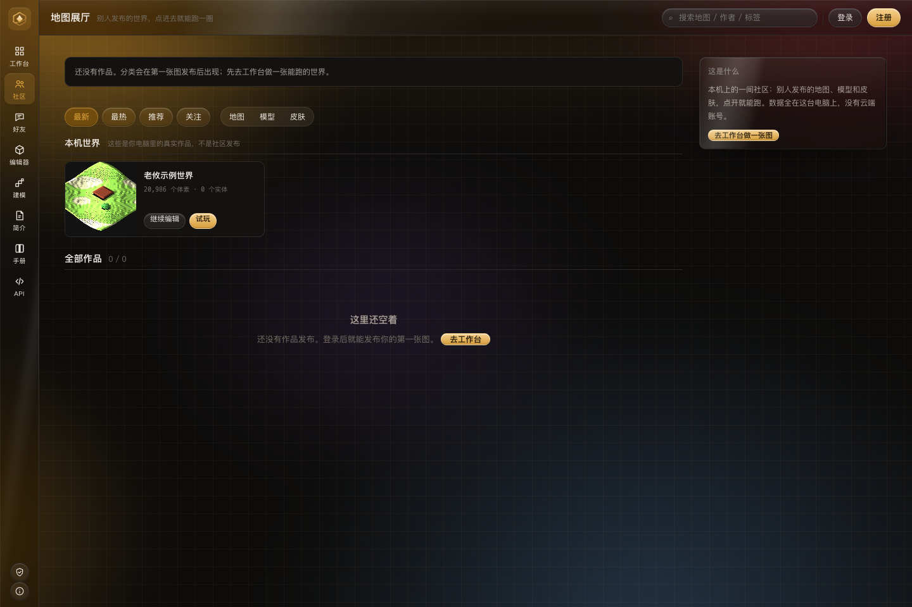
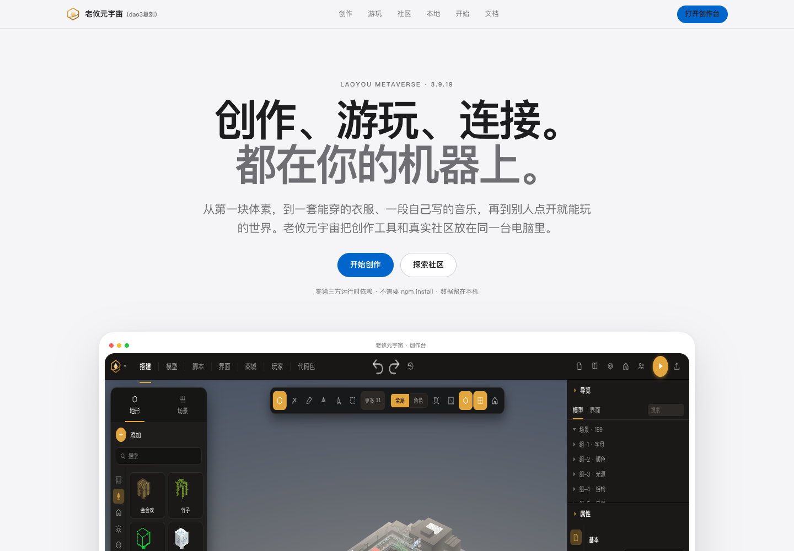
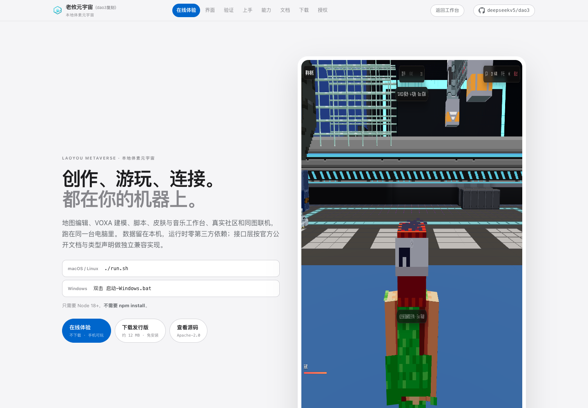
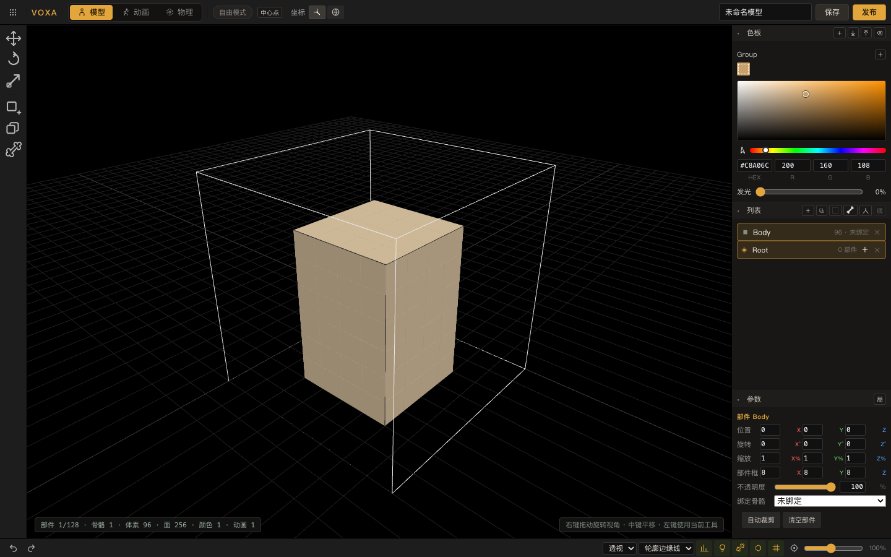

# 老攸元宇宙（dao3复刻）最近更新全览

> 覆盖 3.9.13 → 3.9.26。本文图片全部来自本机真实运行截图，不是概念图、渲染图或 AI 生成图。

这段时间不是零散修补，而是把产品从“能用的本地工具”推进到一套完整创作产品：统一的液态玻璃界面、新的品牌名、VS Code 级脚本工作区、积木编辑器、完整皮肤工作台、音乐编辑器、真实社区，以及能吃下 310 MB 官方导出包的新导入链路。

---

## 一张时间线

| 版本 | 主题 |
| --- | --- |
| 3.9.13 | 液态玻璃材质落地，修掉“玻璃变量没加载”的根因 |
| 3.9.14 | 脚本工作区开始 VS Code 化：活动栏、资源管理器、多标签、面包屑 |
| 3.9.15 | 换 VS Code Dark+ 原色，补小地图、脏标签、JS 角标 |
| 3.9.16 | 重写脚本页布局层，补分栏、右键菜单、查找替换、括号与缩进线 |
| 3.9.18 | 积木编辑器重做：真块形、指针拖拽、撤销、缩放、回收站 |
| 3.9.19 | 新默认角色、完整皮肤工作台、音乐编辑器、社区修复 |
| 3.9.20 | 310 MB ArenaPro 包导入、官方 UI/图片/音效导入、gzip 存档、苹果式官网 |
| 3.9.21 | 1048 个模型全量入库并按需解析，修脚本编辑器 CSS 冲突 |
| 3.9.22 | 音乐工作台重做：编排、钢琴卷帘、鼓机、调音台、WAV/MIDI 导出 |
| 3.9.23 | 二进制世界缓存、密集体素存储、真实加载进度、源码精灵 1141 个实体恢复 |
| 3.9.24 | 801 种可搜索积木、动态天气、19 种乐器、自动化/分轨、相机安全与加载提速 |
| 3.9.25 | Web Worker 零拷贝解码、DAW 段落标记、运行时天气与相机专项验收 |
| 3.9.26 | 轨道独立混响/延迟发送，专项验收 22/22 |

---

## 一、液态玻璃：先修“玻璃根本没生效”，再谈好不好看

之前的玻璃层有一个隐蔽问题：编辑器页没有加载 `tokens.css`，`--glass-fill`、`--glass-blur` 这些变量全是空的。CSS 变量未定义时，`background: var(--glass-fill)` 不是“保持原色”，而是整条声明失效——所谓玻璃面板实际是透明的。

这一轮把设计变量统一到一个来源，并给所有浮层补齐同一套材料：

- 半透明底 + `backdrop-filter` 模糊，让背后的内容留下色相而不是留下噪点；
- 内侧上缘受光棱、下缘背光棱；
- 外侧软投影，让面板真正“浮”起来；
- 不支持毛玻璃的浏览器自动退回实色，不牺牲可读性；
- 动效统一两档，并尊重 `prefers-reduced-motion`。

*搭建界面：同一套暖石墨底、玻璃浮层与琥珀金强调。*

---

## 二、新品牌名：老攸元宇宙（dao3复刻）

对外展示统一为 **老攸元宇宙（dao3复刻）**：

- README、官网、GitHub Pages、文档页头与页脚；
- GitHub 仓库描述、Topics、历史 Release 标题；
- 页面标题、OG 信息、iOS 主屏名称。

仓库名保留 `deepseekv5/dao3`，不改仓库地址与安装路径。官方接口兼容说明、素材授权与免责声明保持原样。

---

## 三、VS Code 级编程：不只是“深色配色”

脚本工作区这一轮是整层重做，不是换一层皮。

*活动栏、资源管理器、多标签、面包屑、小地图、蓝色状态栏。*

能力包含：

- VS Code Dark+ 原色表，而不是“接近深色的第三套配色”；
- 活动栏、资源管理器、多标签页、脏标签提示、JS 角标；
- 面包屑到函数级：`脚本 › index.js › function onJoin`；
- 小地图：点击跳转、拖动视口亮带、滚轮滚动；
- 括号配对高亮与缩进引导线；
- 查找/替换、行上移下移、删行、注释、跳行、下一个问题；
- 命令面板带快捷键提示；
- `Ctrl+\` 拆分编辑器，可拖两栏宽度；
- 编辑区右键菜单、标签页拖拽排序、中键关闭、右键菜单；
- 底部读数：行、列、选区、缩进、编码、语言。

### 积木编辑器：从“表单列表”变成真积木

- 真块形：顶部凹槽、底部凸榫、事件块帽子形；
- 容器块用自己的颜色延伸成左轨与底压条，子块被包在“口”里；
- 字段是嵌进块身的白色药丸，不再是左侧色条 + 虚线框；
- 指针拖拽：跟手幽灵、落点插入线、拖进容器、拖到回收站删除；
- 搜索、缩放、右键菜单、60 步撤销、空态一键预设；
- 中文变量名直接出码，不再变成 `v_ivrg7a`。

---

## 四、皮肤编辑器：从“选五个颜色”到完整工作台

*64×64 像素画布、部件限定、调色板、实时 3D 试穿。*

能力包含：

- 64×64 展开图绘制：画笔、橡皮、填充、吸色、直线、矩形；
- 笔刷大小、部件限定、撤销/重做；
- PNG 导入与导出；
- 实时 3D 试穿，边画边看；
- 配色与体型滑杆；
- 保存为账号皮肤：PNG 上传成站内资产再写进账号；
- 项目皮肤库与社区发布/取用共用同一套记录；
- 原有 MC 预设、骨骼皮肤、VOXA 换肤全部保留。

同一轮还重做了默认角色：更大的头身比、明确肩线、领口、袖口、门襟、腰带、裤缝、鞋头鞋底；预览补暖主光、冷补光与轮廓光。

---

## 五、音乐编辑器：能编曲，不只是播放器

- 编排视图：多轨音轨、时间标尺、可拖动/拉伸的片段、循环区间与播放头；
- 钢琴卷帘：琴键、音符增删/移动/拉伸、力度 lane、量化；
- 鼓机：9 个鼓垫 + 16 步音序器，点击试听、切换鼓点；
- 11 种 Web Audio 实时合成乐器，一键加入旋律、和弦、琶音、贝斯与鼓点片段；
- 调音台：每轨音量、声像、M/S、实时电平，主输出混响与延迟；
- BPM、拍号、调性、小节、循环、节拍器、世界背景音乐；
- 撤销/重做、项目 JSON 导入导出、WAV 离线渲染、标准 MIDI 导出；
- 实时播放与 WAV 导出共用同一套调度器，不把授权采样带进项目。

---

## 六、导入优化：310 MB / 5565 个文件的官方包能真的打开

测试包：`[源码精灵].zip`，310 MB，5565 个文件，包含 1048 个 glTF 模型。

旧链路的三个问题：

1. 整包 310 MB 读进浏览器内存；
2. 并发解析 1048 个 glTF（245 MB），主线程卡死；
3. 1491 万方块的 217 MB JSON 撞上 80 MB 请求上限，只报 `Failed to fetch`。

新链路：

- zip 改为 **Blob 随机访问**，只读目录与按需条目；
- 认 ArenaPro 布局：`config/`、`assets/scripts/`、根目录 `voxel-sparse.gz`；
- 官方 `uiTree` 转成本地界面控件，完整屏幕树保存在 `meta.uiTree`；
- UI 引用的图片与音效写进世界资产；
- **全部 1048 个模型文件逐个写入资产库**，实测 190 MB、5.7 秒、1048/1048；
- 模型解析按需触发，不再导入/重开时并发解析上千个；
- 存档改浏览器 gzip 上传，服务端透明解压；
- 全零旋转数组不再生成 1500 万个 0。

实测结果：

| 项目 | 结果 |
| --- | --- |
| 世界尺寸 | 512 × 512 × 512 |
| 方块数 | 14,913,277 |
| 脚本 | 3 个 |
| 可见 UI 控件 | 108 个 |
| UI 图片 | 156 张 |
| 音效 | 162 个 |
| 模型 | 1048 个 / 190 MB |
| 存档 JSON | 217 MB → 25.9 MB gzip |
| 保存耗时 | 约 16 秒 |

---

## 七、社区：不再用零分类墙占满首屏

- 空社区不再铺十块 `0 张` 分类；
- 首屏展示本机真实世界，可继续编辑或试玩，并明确标注不是社区发布；
- 分页 offset 改为累计，第三页不再重复；
- 快速切筛选时旧请求不会覆盖新结果；
- 精选位只收地图，不再把模型/皮肤送进“开始游玩”；
- 模型/皮肤详情改用各自名词与计数口径；
- 个人页新增皮肤页签；
- 窄卡片计数允许换行，不再挤出卡片。

---

## 八、官网与 GitHub Pages：苹果式浅色产品页

*本地官网 `/site`：大留白、真实产品截图、克制滚动动效。*

*GitHub Pages：浅色文档站与产品介绍共用一套设计语言。*

- 官网与 Pages 全部改为浅色、大留白、真实产品截图；
- 导航、按钮、圆角、阴影、字号统一；
- 官网 `https://.../site`，Pages 根目录即产品介绍；
- 文档正文、侧栏、下载区全部适配浅色主题；
- 下载区移除已失效的 npm 包入口。

---

## 九、VOXA 与工作台仍在同一套产品里

*VOXA：部件、骨骼、动画、物理盒与换肤一套完成。*

---

## 十、验证与发布

- 创意回归：15/15；
- 专项验收覆盖 801 积木编译、中英文搜索、动态天气、自动化、分轨、键盘演奏、相机安全与 512³ 首屏；
- Worker 解码单测覆盖密集/稀疏两条路径，专项浏览器验收 22/22；
- 皮肤回归：14/14；
- 脚本页实测：编辑区宽 821 px、输出栏 300 px，资源管理器与活动栏各归其位；
- 310 MB 包真实浏览器导入成功，模型 1048/1048 落盘；
- 最新发行版：[v3.9.26](https://github.com/deepseekv5/dao3/releases/tag/v3.9.26)；
- 三件发行物：便携包 zip / macOS dmg / Windows exe；
- GitHub Pages：https://deepseekv5.github.io/dao3/

---

## 小结

这几轮的主线只有一句：把“看起来像”换成“真的能用”。

玻璃不是贴一张半透明背景，而是同一套受光、背光与投影；VS Code 不是换一套深色，而是活动栏、标签、面包屑、小地图与快捷键都在；皮肤不是五个色块，而是能画 64×64、能试穿、能保存；音乐不是播放器，而是能画音符、能编曲、能当世界背景音乐；导入不是“选个文件”，而是 310 MB 的官方包也能打开，并把 1048 个模型、156 张图、162 个音效全部留在本机。
